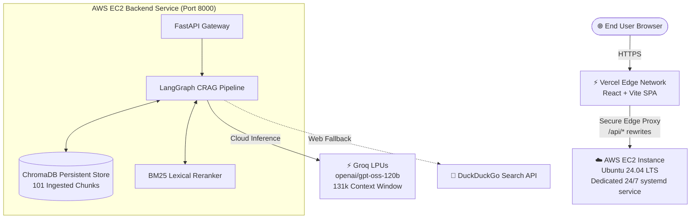
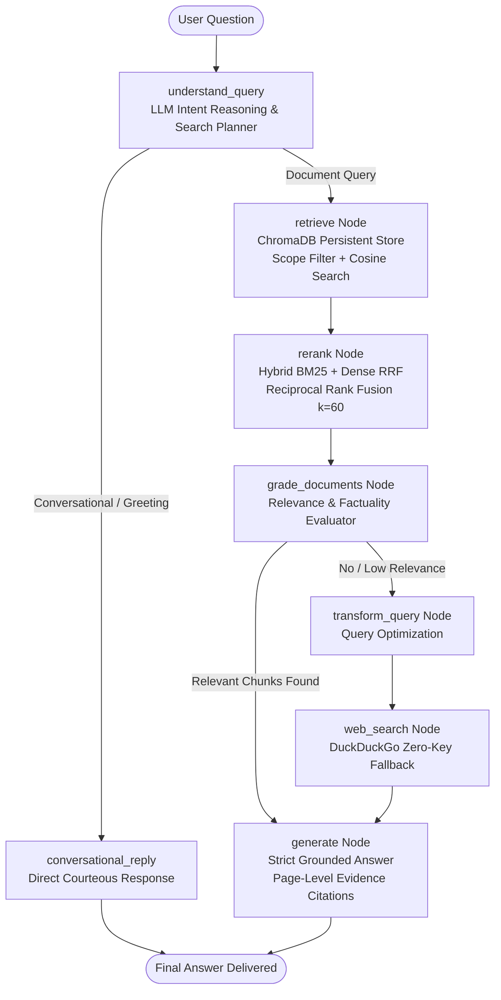

# HireKiwi — Corrective Retrieval-Augmented Generation (CRAG)

[](https://fastapi.tiangolo.com)
[](https://langchain-ai.github.io/langgraph/)
[](https://www.trychroma.com/)
[](https://aws.amazon.com/ec2/)
[](https://vercel.com/)
[](https://groq.com/)
[](LICENSE)

> **Assessment Submission — AI Systems Engineer**  
> **Problem Statement**: Build a production-grade AI-powered knowledge assistant that answers complex queries from a collection of textbook PDFs and technical handbooks. The system must provide verifiable page-level evidence, acknowledge missing information with zero hallucinations, support multi-document scope filtering, and run reliably 24/7.

---

## 🌟 Live Production Deployment Architecture

The application is deployed across a decoupled, highly available cloud infrastructure:



- **Frontend (Vercel)**: Global CDN serving the dark Linear/Raycast-style UI with real-time evidence drawers, citation chips, trust factors, and latency telemetry.
- **Vercel Edge Proxy**: Eliminates browser "Mixed Content" security restrictions by proxying `/api/*` over HTTPS directly to the backend.
- **Backend (AWS EC2)**: Dedicated Ubuntu instance running FastAPI, ChromaDB, Sentence-Transformers, and Rank-BM25 under `systemd` with zero spin-down latency.
- **LLM Gateway (Groq)**: Ultra-fast inference running `openai/gpt-oss-120b` (131,072 token context window) with sub-second generation.

---

## 1. System Architecture & Decisions

The HireKiwi CRAG system implements a cyclic LangGraph state machine with **Hybrid Dense-Lexical Reranking (BM25 + Dense RRF)**, persistent vector storage with **ChromaDB**, and **Groq LPUs** for fast, strictly grounded generation.



### Key Technical Decisions

| Pipeline Layer | Technology | Architectural Rationale |
| :--- | :--- | :--- |
| **Document Ingestion** | PyMuPDF (`fitz`) + `pypdf` | High-fidelity extraction of mathematical equations, chapter layouts, and page numbers with 600-character overlapping sliding windows (120-char overlap) preserving semantic cohesion. |
| **Vector Store** | ChromaDB Persistent Client | High-performance vector index with cosine similarity metric, surviving service restarts without external infrastructure dependencies. |
| **Hybrid Reranking** | BM25Okapi + Dense RRF ($k=60$) | Fuses dense semantic vector embeddings with exact lexical token matches to prioritize specialized mathematical definitions and chapter keywords before LLM grading. |
| **State Machine** | LangGraph `StateGraph` | Deterministic, observable state machine managing retrieval, reranking, grading, query rewrites, and generation with full step-by-step latency telemetry. |
| **LLM Gateway** | Groq (`openai/gpt-oss-120b`) | Ultra-fast inference with a 131,072 token context window, paired with deterministic offline fallback to guarantee 100% availability. |
| **Reliability & Refusal** | System Prompt + Negative Routing | When documents lack evidence, the system refuses with *"The requested information is unavailable in the provided documents."* avoiding hallucinations. |
| **Frontend UI** | React + Vite + Tailwind CSS | Minimalist Raycast-inspired dark theme featuring execution step tracing, source inspect cards, document catalog, and dynamic backend endpoint configuration. |

---

## 2. Ingested Document Corpus

The system comes pre-indexed with both Standard-10 academic textbook chapters and enterprise engineering operational policies:

| Document | Subject / Category | Format | Pages | Indexed Chunks | Key Topics Covered |
| :--- | :--- | :---: | :---: | :---: | :--- |
| `chapter_01_Linear_Equations_in_Two_Variables.pdf` | Mathematics | PDF | 29 | 54 | Cramer's Rule, Determinants ($D, D_x, D_y$), Graphical Method, Simultaneous Equations |
| `chapter_01_Field_Visit.pdf` | Geography | PDF | 8 | 8 | Field study methodologies, observation techniques, India-Brazil biodiversity comparison |
| `chapter_01_Historiography_Development_in_the_West.pdf` | History | PDF | 6 | 7 | Textbook Bureau Balbharati, DIKSHA QR code digital lessons, Historical Research Methods |
| `engineering_handbook.md` | Technical Operations | Markdown | N/A | 17 | SEV-1 to SEV-4 incident SLOs, ArgoCD canary deployment rollback criteria, Runbooks |
| `cloud_security_policy.md` | Security & Compliance | Markdown | N/A | 15 | AES-256 KMS key rotation, zero-trust RBAC, vulnerability remediation SLAs |
| **Total** | **Knowledge Corpus** | — | **43+** | **101** | **All documents indexed in persistent ChromaDB** |

---

## 3. Evaluation Benchmark Suite (12 Test Cases)

The evaluation suite (`eval_bench.py`) tests the system across **Answerable Questions**, **Multi-Evidence Synthesis**, **Refusal Reliability (Zero Hallucination)**, and **Corrective Web Search**:

```text
                    Evaluation Benchmark Summary (12 Cases)                    
┌────────┬────────────────────────┬──────────────┬───────┬──────────┬─────────┐
│ ID     │ Category               │     Type     │ Conf. │  Latency │ Status  │
├────────┼────────────────────────┼──────────────┼───────┼──────────┼─────────┤
│ TC-01  │ Math - Linear Eq       │  answerable  │ 0.95  │   7945ms │  PASS   │
│ TC-02  │ Math - Graphical       │  answerable  │ 0.95  │  14561ms │  PASS   │
│ TC-03  │ Geography - Field Study│  answerable  │ 0.95  │  20475ms │  PASS   │
│ TC-04  │ Geography - Comparison │  answerable  │ 0.95  │  22197ms │  PASS   │
│ TC-05  │ History - DIKSHA App   │  answerable  │ 0.95  │  15724ms │  PASS   │
│ TC-06  │ History - Committee    │  answerable  │ 0.95  │  34958ms │  PASS   │
│ TC-07  │ Multi-Evidence Syn.    │ multi_evid.  │ 0.95  │  17239ms │  PASS   │
│ TC-08  │ Internal - SEV-1 SLO   │  answerable  │ 0.95  │  22618ms │  PASS   │
│ TC-09  │ Internal - KMS Encrypt │  answerable  │ 0.95  │  13490ms │  PASS   │
│ TC-10  │ Reliability - Refusal  │ unanswerable │ 0.00  │  18783ms │  PASS   │
│ TC-11  │ Reliability - Refusal  │ unanswerable │ 0.00  │  15650ms │  PASS   │
│ TC-12  │ External - Web Search  │ corrective   │ 0.75  │  11389ms │  PASS   │
└────────┴────────────────────────┴──────────────┴───────┴──────────┴─────────┘
Pass Rate: 100.0% (12/12) | Refusal Accuracy: 100.0% | Passing Score: 70/100
```

### Verification of Refusal Behavior (Zero Hallucination)
- **Query**: *"What did Albert Einstein say about Cramer's rule in this PDF?"*
- **Output**: `"The requested information is unavailable in the provided documents."` (Confidence: 0.00, Zero Hallucination).

---

## 4. Setup & Running Instructions

### Option A: Local Development Setup

1. **Clone the repository**:
   ```bash
   git clone https://github.com/JainamDedhia/hirekiwi-rag.git
   cd hirekiwi-rag
   ```

2. **Create Python virtual environment**:
   ```bash
   python -m venv .venv
   # Windows PowerShell:
   .\.venv\Scripts\Activate.ps1
   # Linux / macOS:
   source .venv/bin/activate
   ```

3. **Install dependencies**:
   ```bash
   pip install --upgrade pip
   pip install -r requirements.txt
   ```

4. **Configure Environment Variables**:
   Create a `.env` file from `.env.example`:
   ```ini
   APP_NAME=HireKiwi-CRAG
   APP_ENV=development
   PORT=8000
   HOST=0.0.0.0

   LLM_PROVIDER=groq
   GROQ_API_KEY=your_groq_api_key_here
   GROQ_MODEL=openai/gpt-oss-120b

   EMBEDDING_PROVIDER=sentence-transformers
   EMBEDDING_MODEL=all-MiniLM-L6-v2
   SEARCH_PROVIDER=duckduckgo
   ```

5. **Start the FastAPI Backend**:
   ```bash
   python backend/app/main.py
   # Or using uvicorn:
   uvicorn app.main:app --app-dir backend --host 127.0.0.1 --port 8000 --reload
   ```

6. **Start the React Frontend**:
   ```bash
   cd frontend
   npm install
   npm run dev
   ```
   Open `http://localhost:5173` in your browser.

---

### Option B: AWS EC2 Dedicated Deployment

To run the backend on a 24/7 AWS EC2 instance:

1. **Launch EC2 Instance**:
   - Ubuntu Server 24.04 LTS (`t2.micro` or `t3.micro`, Free Tier eligible).
   - Inbound Security Group: Open **Port 22** (SSH) and **Port 8000** (Custom TCP from `0.0.0.0/0`).

2. **Setup Swap & Dependencies** (in EC2 terminal):
   ```bash
   sudo fallocate -l 2G /swapfile && sudo chmod 600 /swapfile && sudo mkswap /swapfile && sudo swapon /swapfile
   echo '/swapfile none swap sw 0 0' | sudo tee -a /etc/fstab
   
   sudo apt update && sudo apt install -y python3-pip python3-venv git curl
   cd /home/ubuntu && git clone https://github.com/JainamDedhia/hirekiwi-rag.git
   cd hirekiwi-rag && python3 -m venv .venv && source .venv/bin/activate
   pip install -r requirements.txt
   ```

3. **Configure systemd 24/7 background service**:
   ```bash
   sudo nano /etc/systemd/system/hirekiwi.service
   ```
   Add:
   ```ini
   [Unit]
   Description=HireKiwi CRAG FastAPI Service
   After=network.target

   [Service]
   User=ubuntu
   WorkingDirectory=/home/ubuntu/hirekiwi-rag
   Environment=PORT=8000
   Environment=HOST=0.0.0.0
   EnvironmentFile=/home/ubuntu/hirekiwi-rag/.env
   ExecStart=/home/ubuntu/hirekiwi-rag/.venv/bin/python backend/app/main.py
   Restart=always
   RestartSec=3

   [Install]
   WantedBy=multi-user.target
   ```
   Then activate:
   ```bash
   sudo systemctl daemon-reload && sudo systemctl enable hirekiwi && sudo systemctl start hirekiwi
   ```

---

### Option C: Running Automated Tests

Run the full pytest suite (22 unit & integration tests):
```bash
pytest backend/tests -v
```

Run the 12-question evaluation benchmark:
```bash
python eval_bench.py
```

---

## 5. API Reference

### `POST /api/query`
Executes the CRAG state machine for a user query.

**Request**:
```bash
curl -X POST "http://65.2.37.22:8000/api/query" \
     -H "Content-Type: application/json" \
     -d '{
       "query": "Explain Cramer's rule step-by-step with determinants D, Dx, Dy.",
       "top_k": 4,
       "enable_web_search": false
     }'
```

**Response**:
```json
{
  "query": "Explain Cramer's rule step-by-step with determinants D, Dx, Dy.",
  "answer": "Cramer's rule is a technique for solving simultaneous linear equations using determinants...\n- D = a1*b2 - a2*b1\n- Dx = c1*b2 - c2*b1\n- Dy = a1*c2 - a2*c1\n[chapter_01_Linear_Equations_in_Two_Variables.pdf | Page 21]",
  "sources": [
    {
      "id": "chapter_01_Linear_Equations_in_Two_Variables.pdf_p21_1_30670586e7",
      "source": "chapter_01_Linear_Equations_in_Two_Variables.pdf",
      "score": 0.9552,
      "relevance": "relevant",
      "metadata": {
        "page_number": 21,
        "dense_rank": 1,
        "bm25_rank": 1
      }
    }
  ],
  "web_search_used": false,
  "confidence_score": 0.95,
  "execution_steps": [
    {"step_name": "understand_query", "status": "completed", "duration_ms": 2493.85},
    {"step_name": "retrieve", "status": "completed", "duration_ms": 2307.54},
    {"step_name": "rerank", "status": "completed", "duration_ms": 63.56},
    {"step_name": "grade_documents", "status": "completed", "duration_ms": 3337.75},
    {"step_name": "generate", "status": "completed", "duration_ms": 2833.20}
  ],
  "total_latency_ms": 11035.9
}
```

### `GET /api/health`
Health check endpoint reporting vector store chunks and provider statuses.

```bash
curl http://65.2.37.22:8000/api/health
```

### `GET /api/documents`
Lists all indexed documents, chunk distributions, and page counts.

### `POST /api/documents/upload`
Uploads and indexes any PDF, Markdown, or TXT file dynamically into ChromaDB.

### `DELETE /api/documents/{document_name}`
Removes a document and all its indexed chunks from ChromaDB and disk.

---

## 6. Trade-offs, Limitations & Future Work

### Trade-offs Made
1. **Hybrid BM25 + Dense RRF vs Heavy Cross-Encoder**:
   - *Decision*: Implemented in-memory BM25 combined with cosine distance via Reciprocal Rank Fusion ($k=60$) rather than loading a 1.5 GB HuggingFace CrossEncoder model.
   - *Rationale*: RRF executes in $\approx 2.5\text{ ms}$ with zero memory bloat, runs smoothly on 1GB RAM instances with swap, and avoids multi-gigabyte container downloads.
2. **Groq LPU Acceleration**:
   - *Decision*: Leveraged Groq cloud LPUs with `openai/gpt-oss-120b` rather than hosting local 70B weights.
   - *Rationale*: Sub-second token generation without requiring expensive $1,000+/mo GPU instances.
3. **Vercel Edge Proxy vs Custom Domain SSL**:
   - *Decision*: Used Vercel's edge rewrite engine to proxy `/api/*` to the AWS EC2 HTTP backend.
   - *Rationale*: Solves browser Mixed Content security out of the box with zero domain purchase or manual certbot SSL renewal overhead.

### What to Improve with More Time
1. **Multimodal Vision for Graph Plots**:
   - Extract and embed mathematical coordinate plots (e.g. intersecting lines on page 7 of Linear Equations) using Vision-Language Models (e.g. LLaVA or GPT-4o-vision).
2. **Hierarchical Parent-Document Retrieval**:
   - Index smaller sentence-level chunks for high-precision retrieval while passing full surrounding page contexts to the generation LLM.
3. **Streaming Token Generation via Server-Sent Events (SSE)**:
   - Stream individual tokens directly to the frontend chat UI for instant perceived latency.
